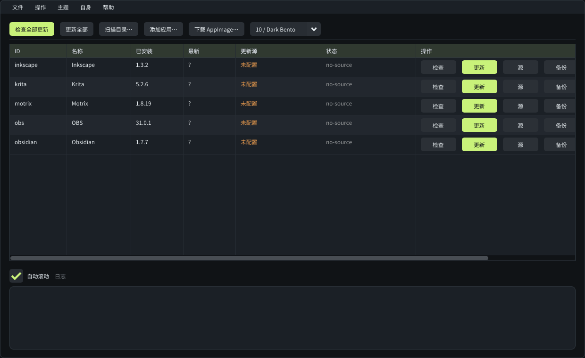

# aimgr

**Linux AppImage 更新、备份与回滚管理器。**

`aimgr` 为目录中的 AppImage 绑定 GitHub Release 或下载 URL，提供版本检查、校验下载、版本化备份、原子替换、回滚、桌面项管理与自更新。命令行 `aimgr` 与图形界面 `aimgr-gui` 共用同一套核心逻辑。



## 功能

### 更新

- **两种更新源**
  - GitHub Release：自动解析 `owner/repo`，按正则选择资产，并按宿主架构排序（`x86_64`、`aarch64`、`armv7`、`i686`、`riscv64`）。
  - 下载 URL：支持固定 URL 和 `${version}` 模板，可从独立版本页或 URL 文件名提取版本。
- **版本比较**：兼容 `v1.2.3`、`1.2`、`2025.09.21`、`1.0.0-rc1`、`1.0.0+build`。
- **无版本 URL 源**：检查结果为 `unknown`；已有目标不会被静默替换，GUI 弹确认框，CLI 使用 `update --force`。
- **GitHub API 限流回退**：匿名 API 返回 403/429 时自动改用 `releases/latest` 与 `expanded_assets` 网页解析。
- **断点续传**：下载使用 `.part` 文件与 HTTP Range，服务端忽略 Range 时自动重下。
- **完整性校验**：文件大小、可选 SHA-256、ELF 与 AppImage 魔数；校验失败不会触碰现有文件。
- **dry-run**：查看将要下载与替换的目标，不落盘。

### 备份与恢复

- 更新前按版本创建备份；同文件系统优先硬链接，跨分区自动复制。
- `backup_keep` 控制保留数量，`prune` 手动清理。
- `rollback` 可按版本或 `latest` 回滚；回滚前会保存当前版本，因此回滚本身也可撤销。
- 使用 journal + 同目录 staging + `fsync` + `rename()`：进程崩溃或被终止后，下次启动自动判断“已经替换成功”还是“需要恢复备份”。

### 管理

- **扫描**：单目录或多目录，可递归进入子目录；自动识别版本，冲突 ID 自动编号，重复扫描不重复登记。
- **下载并登记**：从 GitHub Release 或 URL 直接下载到指定目录，可选 ID、名称、文件名与覆盖。
- **卸载**：删除登记、移动 AppImage 到备份、清理备份，或保留配置。
- **每个 App 的 `.desktop`**：创建、修改、删除名称、说明、分类、图标、附加参数和 `Terminal`；`Exec` 始终指向受管理的 AppImage。
- **自更新**：从自身 GitHub Release 下载、校验、备份并原子替换正在运行的 AppImage；支持自动重启。
- **CLI + GUI**：JSON 输出、脚本化退出码；GUI 支持后台工作线程、进度、日志、确认对话框和主题切换。

### 安全边界

- 默认只允许 HTTPS，重定向链同样受限。
- 不经过 shell；外部辅助程序使用绝对路径与 `execv()`。
- ID 白名单、路径组件清理、目录包含关系校验。
- `O_NOFOLLOW`、`mkstemp()` 临时文件、原子 `rename()`、跨进程 `flock`。
- GitHub token 仅发送到配置的 API 主机，不发送到用户填写的版本页或校验和页。
- 详细威胁模型与处置见 [SECURITY.md](SECURITY.md)。

## 架构

```
┌──────────────────────────┐   ┌──────────────────────────┐
│ aimgr (CLI)              │   │ aimgr-gui                │
│ src/main.cpp             │   │ gui/app.cpp              │
└────────────┬─────────────┘   └────────────┬─────────────┘
             │                              │
             └──────────────┬───────────────┘
                            ▼
                 ┌─────────────────────┐
                 │ Manager             │
                 │ check / update      │
                 │ rollback / uninstall│
                 │ scan / journal      │
                 └──────┬───────┬──────┘
                        │       │
          ┌─────────────┘       └──────────────┐
          ▼                                    ▼
┌─────────────────────┐             ┌─────────────────────┐
│ Source resolution   │             │ Local state         │
│ GitHub API / web    │             │ Config              │
│ URL + version page  │             │ Cache / backups     │
└──────────┬──────────┘             │ Journal / lock      │
           ▼                        └─────────────────────┘
┌─────────────────────┐
│ Http (libcurl)      │
│ retry / resume / TLS│
└──────────┬──────────┘
           ▼
┌─────────────────────┐
│ SHA-256 + AppImage  │
│ structure validation│
└─────────────────────┘
```

### 模块

| 路径 | 职责 |
|---|---|
| `src/main.cpp` | CLI 解析、命令分发、JSON 输出、退出码 |
| `gui/app.cpp` | SDL2 + OpenGL3 + Dear ImGui 前端，工作线程与快照渲染 |
| `src/manager.cpp` | 检查、更新、备份、回滚、卸载、扫描、桌面项、恢复 |
| `src/source.cpp` | GitHub Release 与 URL 源解析、资产选择、网页回退 |
| `src/http.cpp` | libcurl GET/下载、重定向、断点续传、大小上限、TLS |
| `src/config.cpp` | `config.json` 读写与加载校验 |
| `src/selfupdate.cpp` | 自更新、启动器项、已安装版本状态 |
| `src/util.cpp` | 原子写/复制、文件锁、路径与 AppImage 结构检查、字符串清理 |
| `src/sha256.cpp` | 流式 SHA-256 |
| `src/json.cpp` | 无外部依赖的 JSON 解析与序列化 |
| `src/version.cpp` | 版本规范化、比较与提取 |
| `third_party/imgui` | Dear ImGui 子模块（Me-Maped/imgui） |

### 更新事务

```
resolve
  → download (.part, resume)
  → verify (size / sha256 / ELF + AI magic)
  → backup (hardlink or copy)
  → journal(stage=swapping)
  → staging + fsync
  → rename() atomic replace
  → save config
  → remove journal
  → prune
```

- 任一步失败时，目标文件保持原样。
- `rename()` 后发生异常时，从备份恢复。
- journal 写入状态目录，权限 `0600`；恢复前校验目标与备份路径。
- 所有写操作由进程锁串行化。

### 数据目录

默认遵循 XDG：

```
~/.config/aimgr/config.json                 配置
~/.local/state/aimgr/journal.json           中断事务记录
~/.local/state/aimgr/aimgr.lock             跨进程锁
~/.local/state/aimgr/self.json              自更新版本状态
~/.local/share/aimgr/backups/<app-id>/      备份与元数据
~/.cache/aimgr/downloads/<app-id>/<version>/ 下载缓存
~/.local/share/applications/aimgr-<id>.desktop
```

可用 `AIMGR_CONFIG`、`AIMGR_STATE_DIR`、`AIMGR_CACHE_DIR`、`AIMGR_BACKUP_DIR` 覆盖。

## 构建

依赖：

- CMake ≥ 3.20
- C++20 编译器
- libcurl
- SDL2、OpenGL（GUI）
- Dear ImGui 子模块

Arch / CachyOS：

```bash
sudo pacman -S --needed base-devel cmake curl sdl2 mesa
```

Debian / Ubuntu：

```bash
sudo apt install build-essential cmake libcurl4-openssl-dev libsdl2-dev libgl1-mesa-dev
```

构建：

```bash
git clone --recursive https://github.com/Me-Maped/appimage-manager.git
cd appimage-manager
cmake -S . -B build -DCMAKE_BUILD_TYPE=Release
cmake --build build -j"$(nproc)"

./build/aimgr --version
./build/aimgr-gui
ctest --test-dir build --output-on-failure
```

如果克隆时漏了子模块：

```bash
git submodule update --init --recursive
```

CMake 选项：

```bash
cmake -S . -B build -DAIMGR_BUILD_GUI=OFF
cmake -S . -B build -DAIMGR_IMGUI_DIR=/path/to/imgui
cmake -S . -B build -DAIMGR_SELF_REPO=owner/repo
```

安装：

```bash
sudo cmake --install build
```

安装内容：`aimgr`、`aimgr-gui`、桌面项与图标。

AppImage 打包：

```bash
packaging/build-appimage.sh
```

该脚本需要 `appimagetool`。

## 使用

### 快速开始

```bash
# 扫描已有 AppImage
aimgr scan --recursive ~/Apps ~/Downloads/AppImages

# 配置 GitHub Release 更新源
aimgr set-source motrix --github agalwood/Motrix

# 检查与更新
aimgr check
aimgr update motrix

# 查看备份与回滚
aimgr backups motrix
aimgr rollback motrix
```

### 从源下载

```bash
# GitHub Release
aimgr download --github agalwood/Motrix --dir ~/Apps

# 指定资产
aimgr download --github owner/repo \
  --asset-regex 'x86_64.*\.AppImage$' --dir ~/Apps

# 普通下载 URL
aimgr download --url https://example.com/apps/tool.AppImage \
  --dir ~/Apps --id tool --name Tool --filename Tool.AppImage
```

`install` 是 `download` 的同义词。同名文件或应用默认拒绝覆盖，使用 `--replace` 显式允许。

### URL 源

```bash
aimgr add --id foo --name Foo --path ~/Apps/foo.AppImage \
  --url 'https://example.com/foo-${version}.AppImage' \
  --version-url 'https://example.com/latest.txt' \
  --version-regex '([0-9]+\.[0-9]+\.[0-9]+)' \
  --sha256-url 'https://example.com/foo.AppImage.sha256'
```

无版本 URL 的更新：

```bash
aimgr update foo --force
```

### 每个 App 的桌面项

```bash
aimgr integrate motrix \
  --desktop-name "Motrix Downloader" \
  --comment "Manage Motrix" \
  --categories "Network;Utility" \
  --icon /home/you/icons/motrix.png \
  --args "%U"

aimgr deintegrate motrix
```

### 自更新

```bash
aimgr self status
aimgr self update
aimgr self update --restart
aimgr self update --dry-run
aimgr self update --prerelease     # 也跟随 GitHub 预发布（pre-release）
aimgr self integrate
aimgr self remove
```

自更新使用 `AIMGR_SELF_REPO` 或 CMake 中的 `AIMGR_SELF_REPO`。默认只跟随正式发布，
发布 `v0.1.0` 这类 pre-release 时需要 `--prerelease`；校验和直接取自 GitHub release
资产的 `digest` 字段，没有则只做 ELF/AppImage 结构校验。

### 常用脚本

```bash
aimgr check --json | jq -r '.results[] | select(.update_available) | .id'
aimgr check --fail-on-update || aimgr update
aimgr update --dry-run
aimgr uninstall motrix --purge
```

退出码：

| 码 | 含义 |
|---|---|
| `0` | 成功 |
| `1` | 失败 |
| `2` | 用法错误 |
| `3` | 有可用更新（`check --fail-on-update`） |

### 命令

```text
aimgr [全局选项] <命令> [参数]

  list                          列出已登记的应用
  add --path P ...              登记已有 AppImage
  download | install --github owner/repo | --url URL
                                从 release / URL 下载到 --dir 并登记
  set-source <id> ...           配置或更换更新源
  check [id...]                 检查更新
  update [id...]                下载并原子替换
  backups <id>                  列出备份
  rollback <id> [版本|latest]   还原到备份
  prune <id>                    清理旧备份
  uninstall <id> [--purge] [--delete-file] [--keep-config]
  scan [--recursive] [目录...]  扫描 AppImage
  integrate <id> ...            创建或修改 .desktop
  deintegrate <id>              删除 .desktop
  recover                       修复中断事务
  doctor                        打印路径与 API 诊断
  self <status|update|integrate|remove>
  self update [--force] [--prerelease] [--dry-run] [--restart]
  gui                           启动图形界面
```

全局选项：`-c/--config PATH`、`--json`、`-q/--quiet`、`-v/--verbose`、`-h`、`-V`。

## 图形界面

- 启动时只加载本地配置与已管理列表，**不会自动检查更新**；检查全部更新由用户手动触发。
- 表格展示 ID、名称、已安装版本、最新版本、更新源、状态与操作。
- 中间表格支持**横向滚动**，列头分隔线可拖动调整列宽；ID 列与表头在滚动时固定。
- 每行操作：检查、更新/强制更新、更新源、备份、桌面项、卸载。
- 工具栏：检查全部、更新全部、扫描目录、添加应用、下载 AppImage、主题选择。
- 添加应用支持单文件或扫描文件夹（可包含子文件夹）。
- 下载、强制更新、卸载、回滚等破坏性操作使用确认对话框。
- 内置主题来自 Me-Maped/imgui 的主题模块，支持载入和保存 `.ini` 主题。

可用主题：`default`、`cyberpunk`、`minimal`、`wireframe`、`brutalist`、`bento`。

```bash
aimgr-gui --theme cyberpunk
```

## 配置

默认配置文件为 `~/.config/aimgr/config.json`，CLI 与 GUI 共用。

```json
{
  "schema": 1,
  "defaults": {
    "backup_keep": 3,
    "backup_dir": "/home/you/.local/share/aimgr/backups",
    "download_dir": "/home/you/.cache/aimgr/downloads"
  },
  "ui": {
    "theme": "bento",
    "custom_theme_file": "",
    "font_scale": 1.0,
    "launcher_prompt_done": false
  },
  "apps": [
    {
      "id": "motrix",
      "name": "Motrix",
      "path": "/home/you/Apps/Motrix-1.8.19.AppImage",
      "source": {
        "type": "github",
        "repo": "agalwood/Motrix",
        "asset_regex": "",
        "tag_prefix": "v",
        "allow_prerelease": false
      },
      "installed_version": "1.8.19",
      "backup_keep": -1,
      "pinned": false,
      "desktop": {
        "name": "",
        "comment": "AppImage managed by aimgr",
        "categories": "Utility;",
        "icon": "",
        "args": "%U",
        "terminal": false
      }
    }
  ]
}
```

主要字段：

| 字段 | 含义 |
|---|---|
| `source.type` | `github`、`url` 或 `none` |
| `asset_regex` | GitHub 资产正则，空值为 `.*\.AppImage$` |
| `tag_prefix` | 从 tag 中去掉的前缀，例如 `v` |
| `version_regex` | 从文件名提取版本的备用正则 |
| `backup_keep` | `-1` 使用全局默认；`0` 保留全部；`N` 保留最近 N 个 |
| `pinned` | 跳过检查与更新 |
| `desktop.*` | `.desktop` 生成字段；`Exec` 固定为 AppImage 路径 |

## 更新源细节

### GitHub 资产选择

多个资产匹配正则时按以下规则排序：

1. 宿主架构匹配：`+3`
2. 其它架构：`-10`
3. 辅助文件后缀（`.zsync`、`.sha256`、`.sig`、`.txt`、`.zip` 等）：`-20`

### GitHub API 限流

匿名 API 配额为每小时 60 次。返回 403/429 或连接失败时，回退到：

```text
/releases/latest
  → /releases/tag/<tag>
  → /releases/expanded_assets/<tag>
```

网页通道不提供大小与 SHA-256，因此只做结构校验并输出 warning。设置 `AIMGR_GITHUB_TOKEN` 可避免回退。

### URL 版本来源

优先级：

1. `version_url` + `version_regex`
2. URL 文件名中的版本
3. 无版本（检查状态 `unknown`）

## 环境变量

| 变量 | 作用 |
|---|---|
| `AIMGR_CONFIG` | 配置文件路径 |
| `AIMGR_STATE_DIR` | 状态目录：journal / 锁 / 自更新状态 |
| `AIMGR_CACHE_DIR` | 下载缓存根目录 |
| `AIMGR_BACKUP_DIR` | 备份根目录 |
| `AIMGR_GITHUB_TOKEN` / `GITHUB_TOKEN` | GitHub token |
| `AIMGR_GITHUB_API` | GitHub API base |
| `AIMGR_GITHUB_WEB` | GitHub 网页 base |
| `AIMGR_SELF_REPO` | 自更新仓库 |
| `AIMGR_ALLOW_INSECURE_HTTP` | 允许明文 HTTP（仅测试或可信镜像） |
| `AIMGR_MAX_DOWNLOAD_BYTES` | 单文件下载上限，默认 8 GiB |
| `NO_COLOR` | 关闭彩色输出 |

## 测试

```bash
ctest --test-dir build --output-on-failure
```

当前覆盖：

- 单元测试：版本比较、JSON、SHA-256、GitHub 仓库解析、路径与字符串清理。
- 端到端测试：离线 mock GitHub API 与下载站，覆盖更新、校验失败、回滚、网页回退、扫描、下载、强制更新、桌面项、journal 恢复、自更新及安全边界。
- GUI 冒烟测试：Xvfb + 软件 OpenGL，验证截图与主题差异；无显示环境自动跳过。

## 已知限制

- 全量下载，不做 zsync 增量更新。
- 一个应用对应一个本地文件；多架构文件需分别登记。
- 不校验 GPG/Minisign 签名；高价值资产建议配置 SHA-256。
- 自更新只替换正在运行的 AppImage 文件。
- 不自动提取 AppImage 内置图标；桌面项可手动指定 `--icon`。
- GUI 需要 OpenGL 3.0+。

## 许可

MIT，见 [LICENSE](LICENSE)。

`third_party/imgui` 是 [Me-Maped/imgui](https://github.com/Me-Maped/imgui) 子模块，遵循其上游 MIT 许可。
